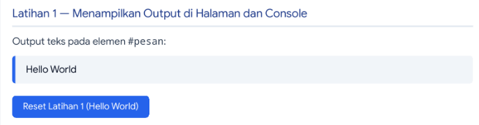
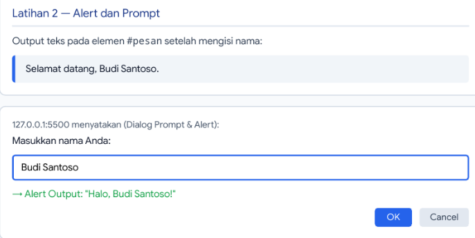
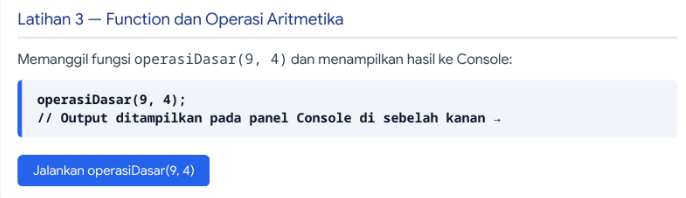
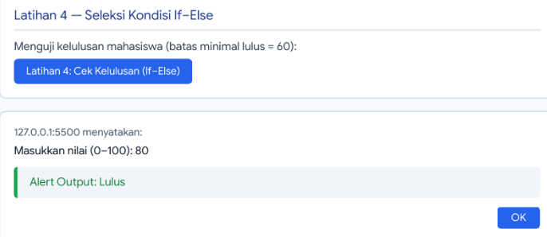
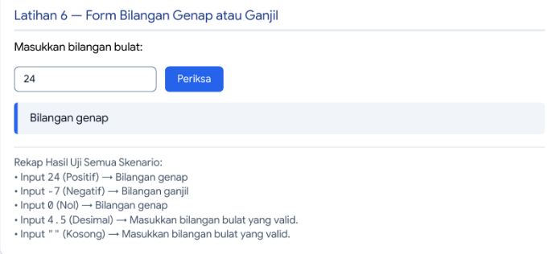
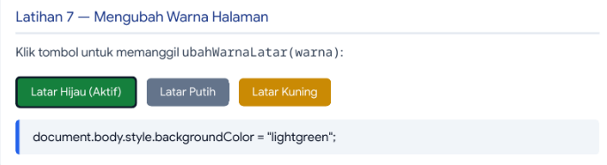
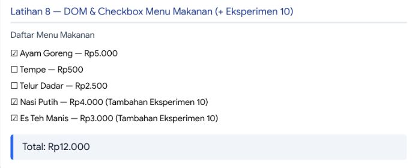
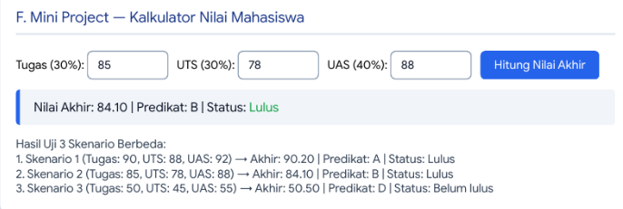
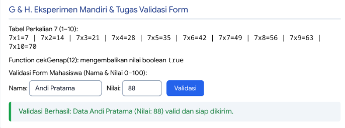

# Praktikum 5: Dasar Pemrograman JavaScript (`Lab5Web`)

Repository ini berisi hasil pengerjaan **Praktikum 5 — Dasar Pemrograman JavaScript**, mencakup **Latihan 1 s.d. Latihan 8**, **Mini Project (Kalkulator Nilai Mahasiswa)**, **Eksperimen Mandiri**, serta jawaban lengkap **Pertanyaan dan Tugas**.

---

## Daftar Isi

1. [Tujuan Praktikum](#1-tujuan-praktikum)
2. [Struktur File Repository](#2-struktur-file-repository)
3. [Langkah Kerja dan Cara Menjalankan](#3-langkah-kerja-dan-cara-menjalankan)
4. [Pembahasan dan Hasil Latihan 1 – 8](#4-pembahasan-dan-hasil-latihan-1--8)
   - [Latihan 1 — Menampilkan Output](#latihan-1--menampilkan-output)
   - [Latihan 2 — Alert dan Prompt](#latihan-2--alert-dan-prompt)
   - [Latihan 3 — Function dan Operasi Aritmetika](#latihan-3--function-dan-operasi-aritmetika)
   - [Latihan 4 — Seleksi Kondisi If–Else](#latihan-4--seleksi-kondisi-ifelse)
   - [Latihan 5 — Seleksi Kondisi Switch](#latihan-5--seleksi-kondisi-switch)
   - [Latihan 6 — Form Bilangan Genap atau Ganjil](#latihan-6--form-bilangan-genap-atau-ganjil)
   - [Latihan 7 — Mengubah Warna Halaman](#latihan-7--mengubah-warna-halaman)
   - [Latihan 8 — DOM dan Checkbox Menu Makanan](#latihan-8--dom-dan-checkbox-menu-makanan)
5. [F. Mini Project — Kalkulator Nilai Mahasiswa](#5-f-mini-project--kalkulator-nilai-mahasiswa)
6. [G. Eksperimen Mandiri](#6-g-eksperimen-mandiri)
7. [H. Jawaban Pertanyaan dan Tugas](#7-h-jawaban-pertanyaan-dan-tugas)

---

## 1. Tujuan Praktikum

1. Mengenali cara menampilkan output JavaScript pada halaman HTML (DOM) dan pada Console browser.
2. Menggunakan dialog interaktif `alert()` dan `prompt()` serta memvalidasi input pengguna.
3. Membuat dan memanggil `function` dengan parameter dan nilai kembalian (`return`) untuk operasi aritmetika maupun logika.
4. Menerapkan struktur seleksi kondisi `if–else` dan `switch` beserta konversi tipe data (`Number()`).
5. Memanipulasi elemen HTML menggunakan Document Object Model (`document.getElementById`, `document.querySelectorAll`) dan menangani event (`onclick`, `addEventListener`).
6. Membangun aplikasi **Kalkulator Nilai Mahasiswa** beserta validasi form.

---

## 2. Struktur File Repository

```text
Lab5Web/
├── index.html                           # Halaman utama yang memuat seluruh latihan & mini project
├── style.css                            # Styling tampilan halaman praktikum
├── script.js                            # Seluruh kode logika JavaScript (Latihan 1-8, Mini Project, Eksperimen)
├── README.md                            # Dokumentasi lengkap laporan praktikum
└── screenshots/                         # Bukti tangkapan layar hasil eksekusi di Browser & Console
    ├── latihan1_output.png
    ├── latihan2_prompt_alert.png
    ├── latihan3_aritmetika.png
    ├── latihan4_ifelse.png
    ├── latihan5_switch.png
    ├── latihan6_genap_ganjil.png
    ├── latihan7_warna_latar.png
    ├── latihan8_checkbox_menu.png
    ├── miniproject_kalkulator_nilai.png
    └── eksperimen_mandiri.png
```

---

## 3. Langkah Kerja dan Cara Menjalankan

### Langkah Kerja

1. Membuat repository baru bernama `Lab5Web`.
2. Membuat file `index.html`, `style.css`, dan `script.js` di dalam folder proyek.
3. Menghubungkan `script.js` di bagian akhir tag `<body>` pada `index.html` (`<script src="script.js"></script>`) agar seluruh elemen DOM telah siap sebelum script dijalankan.
4. Menuliskan kode program secara berurutan dari Latihan 1 hingga Latihan 8, Mini Project, dan Eksperimen Mandiri.
5. Menguji seluruh fitur di browser dan memeriksa output pada **Developer Tools (Console)**.

### Cara Menjalankan

1. Clone atau unduh repository ini:
   ```bash
   git clone https://github.com/username/Lab5Web.git
   cd Lab5Web
   ```
2. Buka file `index.html` menggunakan browser (Google Chrome / Chromium / Firefox) secara langsung atau melalui ekstensi **Live Server** di VS Code.
3. Tekan `F12` atau `Ctrl + Shift + I` lalu pilih tab **Console** untuk melihat output log dari JavaScript.

---

## 4. Pembahasan dan Hasil Latihan 1 – 8

### Latihan 1 — Menampilkan Output

**Tujuan:** Mengenali cara menampilkan output di halaman HTML dan di Console.

**Kode Program:**

```javascript
document.getElementById("pesan").textContent = "Hello World";
console.log("Hello World");
```

**Catatan Perbedaan Output pada Halaman dan Console:**

- **Output pada Halaman (`textContent`):** Mengubah isi teks di dalam elemen HTML (`#pesan`) secara langsung sehingga dapat dilihat oleh pengunjung/pengguna halaman web pada antarmuka utama.
- **Output pada Console (`console.log`):** Menampilkan pesan hanya di panel _Developer Tools -> Console_. Output ini tidak terlihat di halaman utama dan umumnya digunakan oleh developer untuk _debugging_, pemantauan nilai variabel, atau pencatatan log eksekusi.

**Screenshot Hasil:**


---

### Latihan 2 — Alert dan Prompt

**Tujuan:** Mengambil input nama pengguna melalui `prompt()` dan menampilkan sapaan dengan `alert()` serta memperbarui teks pada halaman.

**Kode Program:**

```javascript
const namaPengguna = prompt("Masukkan nama Anda:", "");
if (namaPengguna && namaPengguna.trim() !== "") {
  alert("Halo, " + namaPengguna + "!");
  document.getElementById("pesan").textContent =
    "Selamat datang, " + namaPengguna + ".";
} else {
  alert("Nama belum diisi.");
}
```

**Catatan Perilaku Program Saat Pengujian:**

1. **Memasukkan Nama (misal: `"Budi Santoso"` lalu klik OK):** `namaPengguna` berisi string `"Budi Santoso"`. Kondisi `if` bernilai `true`, sehingga muncul pop-up `alert("Halo, Budi Santoso!")` dan teks pada elemen `#pesan` di halaman berubah menjadi `"Selamat datang, Budi Santoso."`.
2. **Menekan Tombol Cancel:** Fungsi `prompt()` mengembalikan nilai `null`. Kondisi `if (namaPengguna ...)` bernilai `false` (falsy), sehingga program langsung masuk ke blok `else` dan menampilkan `alert("Nama belum diisi.")`.
3. **Membiarkan Input Kosong atau Hanya Spasi lalu Klik OK:** `namaPengguna` berisi `""` atau `"   "`. Karena diperiksa menggunakan `namaPengguna.trim() !== ""`, spasi kosong dihapus menjadi `""` sehingga kondisi bernilai `false` dan program menampilkan `alert("Nama belum diisi.")`.

**Screenshot Hasil:**


---

### Latihan 3 — Function dan Operasi Aritmetika

**Tujuan:** Membuat fungsi yang menerima dua parameter bilangan dan menampilkan hasil penjumlahan, pengurangan, perkalian, pembagian, dan sisa bagi (modulus) ke Console.

**Kode Program:**

```javascript
function operasiDasar(a, b) {
  console.log("Penjumlahan:", a + b);
  console.log("Pengurangan:", a - b);
  console.log("Perkalian:", a * b);
  console.log("Pembagian:", b !== 0 ? a / b : "Tidak dapat dibagi nol");
  console.log("Modulus:", a % b);
}
operasiDasar(9, 4);
```

**Hasil Eksekusi `operasiDasar(9, 4)` di Console:**

- `Penjumlahan: 13`
- `Pengurangan: 5`
- `Perkalian: 36`
- `Pembagian: 2.25`
- `Modulus: 1`

**Screenshot Hasil:**


---

### Latihan 4 — Seleksi Kondisi If–Else

**Tujuan:** Meminta input nilai (0–100) melalui `prompt()`, mengonversi string menjadi `Number`, memvalidasi rentang input, dan menentukan kelulusan (minimal 60).

**Kode Program:**

```javascript
const inputNilai = prompt("Masukkan nilai (0–100):");
const nilaiMahasiswa = Number(inputNilai);
if (
  inputNilai === null ||
  inputNilai.trim() === "" ||
  Number.isNaN(nilaiMahasiswa) ||
  nilaiMahasiswa < 0 ||
  nilaiMahasiswa > 100
) {
  alert("Input nilai tidak valid.");
} else if (nilaiMahasiswa >= 60) {
  alert("Lulus");
} else {
  alert("Belum lulus");
}
```

**Screenshot Hasil:**


---

### Latihan 5 — Seleksi Kondisi Switch

**Tujuan:** Meminta pengguna memasukkan angka 1–5 dan menampilkan nama bilangan menggunakan struktur `switch`.

**Kode Program:**

```javascript
const inputPilihan = prompt("Masukkan angka 1–5:");
switch (inputPilihan) {
  case "1":
    alert("Bilangan satu");
    break;
  case "2":
    alert("Bilangan dua");
    break;
  case "3":
    alert("Bilangan tiga");
    break;
  case "4":
    alert("Bilangan empat");
    break;
  case "5":
    alert("Bilangan lima");
    break;
  default:
    alert("Pilihan tidak tersedia");
}
```

**Screenshot Hasil:**


---

### Latihan 6 — Form Bilangan Genap atau Ganjil

**Tujuan:** Memeriksa apakah input pada form HTML merupakan bilangan bulat yang valid, kemudian menentukan apakah bilangan tersebut genap atau ganjil.

**Kode Program:**

```javascript
function cekBilangan() {
  const input = document.getElementById("bilangan").value;
  const angka = Number(input);
  const hasil = document.getElementById("hasilBilangan");
  if (input.trim() === "" || !Number.isInteger(angka)) {
    hasil.textContent = "Masukkan bilangan bulat yang valid.";
  } else if (angka % 2 === 0) {
    hasil.textContent = "Bilangan genap";
  } else {
    hasil.textContent = "Bilangan ganjil";
  }
}
```

**Rekapitulasi Hasil Pengujian Lima Skenario:**
| Skenario Uji | Nilai Input | Output pada `#hasilBilangan` | Penjelasan |
| :--- | :--- | :--- | :--- |
| Angka Positif | `24` | `Bilangan genap` | `24` adalah integer dan `24 % 2 === 0` |
| Angka Negatif | `-7` | `Bilangan ganjil` | `-7` adalah integer dan `-7 % 2 !== 0` |
| Angka Nol | `0` | `Bilangan genap` | `0` adalah integer dan `0 % 2 === 0` |
| Bilangan Desimal | `4.5` | `Masukkan bilangan bulat yang valid.` | `Number.isInteger(4.5)` bernilai `false` |
| Input Kosong | `""` | `Masukkan bilangan bulat yang valid.` | `input.trim() === ""` bernilai `true` |

**Screenshot Hasil:**


---

### Latihan 7 — Mengubah Warna Halaman

**Tujuan:** Membuat tiga tombol yang mengubah warna latar belakang halaman (`document.body.style.backgroundColor`) menggunakan satu fungsi berparameter.

**Kode Program:**

```javascript
function ubahWarnaLatar(warna) {
  document.body.style.backgroundColor = warna;
}
```

**Screenshot Hasil:**


---

### Latihan 8 — DOM dan Checkbox Menu Makanan

**Tujuan:** Menghitung total harga makanan secara otomatis menggunakan event listener `change` setiap kali checkbox dicentang atau dilepas (sekaligus menambahkan 2 menu baru sesuai Eksperimen Mandiri No. 10).

**Kode Program:**

```javascript
const daftarMenu = document.querySelectorAll(".menu");
daftarMenu.forEach((item) => {
  item.addEventListener("change", hitungTotal);
});
function hitungTotal() {
  let total = 0;
  daftarMenu.forEach((item) => {
    if (item.checked) total += Number(item.value);
  });
  document.getElementById("total").textContent = total.toLocaleString("id-ID");
}
```

**Screenshot Hasil:**


---

## 5. F. Mini Project — Kalkulator Nilai Mahasiswa

Program menerima tiga komponen nilai (**Tugas 30%**, **UTS 30%**, dan **UAS 40%**), memvalidasi agar setiap input tidak kosong dan berada dalam rentang `0–100`, serta memisahkan fungsi perhitungan (`hitungNilaiAkhir`, `tentukanPredikat`, `tentukanStatusKelulusan`) dari fungsi pembaruan tampilan DOM (`tampilkanHasilKalkulator`).

### Hasil Uji Tiga Skenario Berbeda

| Skenario       | Nilai Tugas (30%) | Nilai UTS (30%) | Nilai UAS (40%) | Nilai Akhir | Predikat | Status Kelulusan |
| :------------- | :---------------: | :-------------: | :-------------: | :---------: | :------: | :--------------- |
| **Skenario 1** |        90         |       88        |       92        |  **90.20**  |  **A**   | **Lulus**        |
| **Skenario 2** |        85         |       78        |       88        |  **84.10**  |  **B**   | **Lulus**        |
| **Skenario 3** |        50         |       45        |       55        |  **50.50**  |  **D**   | **Belum lulus**  |

**Screenshot Hasil Mini Project:**


---

## 6. G. Eksperimen Mandiri

Seluruh tugas pada bagian **Eksperimen Mandiri** telah diimplementasikan di dalam `index.html` dan `script.js`:

1. **Nomor 1 (Operasi Dasar dari Prompt):** Fungsi `operasiDasarPrompt()` meminta dua angka lewat `prompt()`, mengonversinya dengan `Number()`, dan menampilkan hasil operasi aritmetika.
2. **Nomor 7 (Tabel Perkalian Angka 7 dari 1 s.d. 10):** Menggunakan perulangan `for (let i = 1; i <= 10; i++)` untuk mencetak `7 x 1 = 7` hingga `7 x 10 = 70` di halaman HTML dan Console.
3. **Nomor 8 (Function `cekGenap(angka)`):**
   ```javascript
   function cekGenap(angka) {
     return angka % 2 === 0;
   }
   ```
4. **Nomor 9 (Validasi Form Tidak Boleh Kosong):** Diterapkan pada form Kalkulator Nilai dan Form Validasi Mahasiswa menggunakan pemeriksaan `.trim() === ""`.
5. **Nomor 10 (Menambah Minimal 2 Pilihan Menu & Harga pada Latihan 8):** Ditambahkan menu **Nasi Putih — Rp4.000** dan **Es Teh Manis — Rp3.000**.
6. **Nomor 11 (Tombol Sembunyikan/Tampilkan Elemen HTML):** Fungsi `toggleInfoTambahan()` mengubah properti `elemen.style.display` antara `"none"` dan `"block"`.

**Screenshot Hasil Eksperimen Mandiri:**


---

## 7. H. Jawaban Pertanyaan dan Tugas

### 1. Jelaskan perbedaan `console.log()`, `alert()`, `prompt()`, dan `textContent`/`innerHTML`.

- **`console.log()`**: Mencetak pesan atau nilai variabel ke tab _Console_ pada Developer Tools browser. Tidak terlihat oleh pengguna biasa di halaman web dan tidak menghentikan jalannya program; digunakan untuk keperluan _debugging_.
- **`alert()`**: Menampilkan kotak dialog pop-up berisi pesan informasi kepada pengguna dengan satu tombol **OK**. Bersifat _blocking_ (menghentikan eksekusi baris kode berikutnya sampai pengguna menekan OK).
- **`prompt()`**: Menampilkan kotak dialog pop-up yang meminta masukan teks dari pengguna beserta tombol **OK** dan **Cancel**. Mengembalikan nilai bertipe `string` jika pengguna menekan OK, atau `null` jika menekan Cancel.
- **`textContent` / `innerHTML`**: Properti DOM untuk membaca atau mengubah isi dari elemen HTML secara langsung di halaman tanpa pop-up. Perbedaannya: `textContent` memperlakukan masukan murni sebagai teks biasa (lebih aman dari XSS), sedangkan `innerHTML` mem-parsing tag HTML di dalam string yang diberikan.

### 2. Apa perbedaan `let` dan `const`? Berikan contoh.

- **`let`** digunakan untuk mendeklarasikan variabel yang nilainya **dapat diubah (di-reassign)** kembali setelah inisialisasi awal.
- **`const`** digunakan untuk mendeklarasikan konstanta/variabel yang referensinya **tidak dapat diubah (tidak bisa di-reassign)** setelah diberikan nilai awal.
- **Contoh:**

  ```javascript
  let totalHarga = 0;
  totalHarga = 5000; // Valid: nilai variabel let dapat diubah

  const batasLulus = 60;
  // batasLulus = 70; // Error (TypeError: Assignment to constant variable)
  ```

### 3. Apa perbedaan operator `==` dan `===` ?

- **Operator `==` (_Loose Equality_)**: Membandingkan kesamaan nilai setelah melakukan konversi tipe data otomatis (_type coercion_). Contoh: `5 == "5"` menghasilkan `true`.
- **Operator `===` (_Strict Equality_)**: Membandingkan kesamaan **nilai sekaligus tipe datanya** tanpa konversi otomatis. Contoh: `5 === "5"` menghasilkan `false` karena tipe `number` berbeda dengan `string`.

### 4. Jelaskan fungsi `if–else` dan `switch`. Kapan masing-masing dapat digunakan?

- **`if–else`**: Mengevaluasi ekspresi boolean yang fleksibel, termasuk perbandingan rentang nilai (`<`, `>`, `<=`, `>=`) maupun kombinasi logika (`&&`, `||`). Digunakan ketika kondisi melibatkan rentang nilai (seperti mengecek nilai ujian `nilai >= 60` atau validasi form kompleks).
- **`switch`**: Mengevaluasi satu ekspresi dan mencocokkannya dengan sejumlah nilai diskrit (`case`) menggunakan perbandingan ketat (`===`). Digunakan ketika terdapat satu variabel dengan banyak pilihan nilai tetap/spesifik (seperti memilih menu angka `"1"` sampai `"5"`).

### 5. Apa fungsi parameter dan `return` dalam function?

- **Parameter**: Variabel penampung pada definisi fungsi untuk menerima data/masukan (argumen) dari luar saat fungsi dipanggil, sehingga fungsi bersifat dinamis dan dapat digunakan berulang kali.
- **`return`**: Mengembalikan hasil olahan/nilai dari dalam fungsi ke pemanggil fungsi dan menghentikan eksekusi fungsi tersebut, sehingga hasilnya dapat disimpan ke dalam variabel atau diproses oleh fungsi lain.

### 6. Bagaimana JavaScript memilih elemen HTML menggunakan `document.getElementById()`?

JavaScript mencari elemen di dalam pohon DOM (_Document Object Model_) berdasarkan nilai atribut `id` yang unik pada tag HTML. Ketika `document.getElementById("pesan")` dipanggil, browser mengembalikan objek elemen HTML yang memiliki atribut `id="pesan"` (atau `null` jika tidak ditemukan), sehingga properti seperti `.textContent`, `.value`, atau `.style` dapat diakses dan dimodifikasi.

### 7. Buat script untuk memvalidasi form agar nama tidak kosong dan nilai berada pada rentang 0–100.

```javascript
function validasiFormMahasiswa() {
  const nama = document.getElementById("inputNamaValidasi").value.trim();
  const inputNilai = document.getElementById("inputNilaiValidasi").value.trim();
  const hasilEl = document.getElementById("hasilValidasiForm");

  if (nama === "") {
    hasilEl.textContent = "Validasi Gagal: Nama tidak boleh kosong!";
    return false;
  }

  const nilai = Number(inputNilai);
  if (inputNilai === "" || Number.isNaN(nilai) || nilai < 0 || nilai > 100) {
    hasilEl.textContent =
      "Validasi Gagal: Nilai harus berada pada rentang 0–100!";
    return false;
  }

  hasilEl.textContent = `Validasi Berhasil: Data ${nama} (Nilai: ${nilai}) valid.`;
  return true;
}
```
